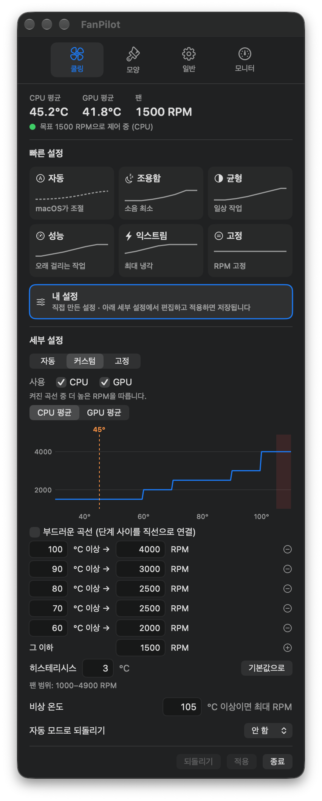
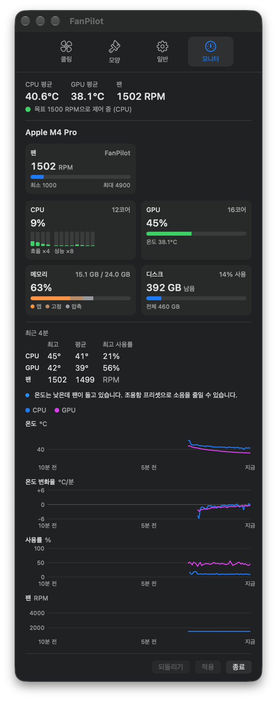
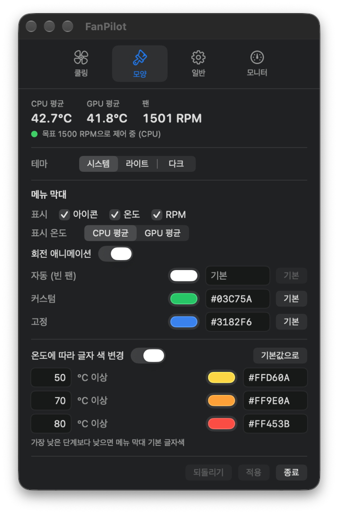
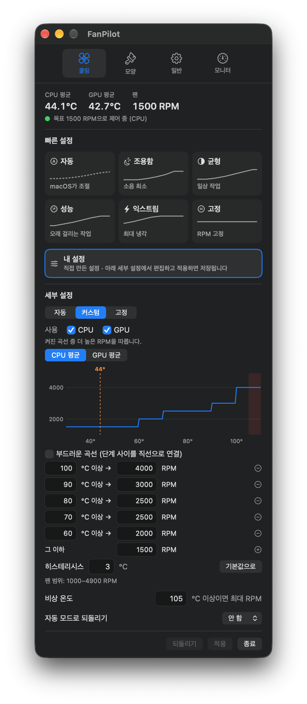
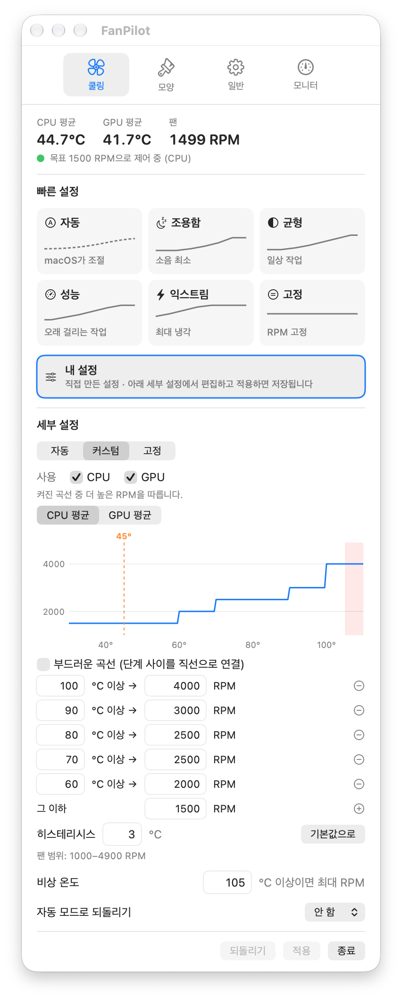

<div align="center">

# FanPilot

**메뉴 막대에서 쓰는, 가볍고 안전한 Mac 팬 컨트롤러**

클릭 한 번으로 쓰는 프리셋과 직접 만드는 CPU·GPU 팬 곡선, 실시간 시스템 모니터를 제공합니다.
언제든 클릭 한 번이면 macOS 기본 제어로 돌아갑니다.

한국어 · [English](README.md)



</div>

---

## 목차

- [주요 기능](#주요-기능)
- [스크린샷](#스크린샷)
- [필요한 환경](#필요한-환경)
- [설치하기](#설치하기)
- [사용 방법](#사용-방법)
- [동작 원리](#동작-원리)
- [안전장치](#안전장치)
- [성능](#성능)
- [직접 빌드하기](#직접-빌드하기)
- [삭제하기](#삭제하기)
- [파일 위치](#파일-위치)
- [자주 묻는 질문](#자주-묻는-질문)
- [주의 사항](#주의-사항)
- [참고한 프로젝트](#참고한-프로젝트)
- [라이선스](#라이선스)

## 주요 기능

**쿨링**
- **빠른 설정:** 자동, 조용함, 균형, 성능, 익스트림, 고정 중 하나만 누르면 바로 적용됩니다. 프리셋은 팬마다 다른 RPM 범위에 맞춰 비율로 정해져 있어서 어떤 Mac에서도 맞게 동작합니다.
- **내 설정:** 직접 만든 설정을 따로 보관합니다. 세부 설정에서 곡선을 고치고 적용하면 저장되고, 프리셋을 눌러도 지워지지 않습니다.
- **CPU와 GPU 곡선을 함께 씁니다.** 둘 중 더 높은 RPM을 따라가기 때문에 게임, 렌더링, 머신러닝처럼 GPU만 뜨거워지는 작업에서도 팬이 제대로 돕니다.
- **단계형 또는 부드러운 곡선**을 고를 수 있고, 지금 온도와 비상 온도 구간이 표시된 그래프로 바로 확인할 수 있습니다.
- **히스테리시스**로 경계 온도에서 팬 속도가 오락가락하지 않습니다.
- **비상 온도**(기본 105 °C, 변경 가능)를 넘으면 자동 모드가 아닐 때 팬을 최대로 돌립니다.
- **자동 모드로 되돌리기:** 커스텀·고정 모드를 15분, 30분, 1시간 뒤 자동으로 돌려놓습니다. 서비스가 처리하므로 앱을 꺼 둬도 동작합니다.
- **팬 여러 개 지원:** 팬이 2개 이상인 Mac에서는 팬마다 카드가 생기고, 모든 팬이 각자의 범위에 맞춰 같은 비율로 돕니다.

**모니터**
- 칩 이름과 코어 구성(성능·효율 코어, GPU 코어), 팬별 RPM과 최소·최대값
- 코어별 막대가 있는 CPU 사용률, GPU 사용률, 메모리(앱·고정·압축), 시동 디스크 남은 용량
- 최근 10분 그래프: 온도, **온도 변화율(°/분)**, 사용률, 팬 RPM. 최고·평균값과 함께 "온도가 꽤 올라갔습니다. 성능 프리셋이 더 잘 식힙니다"처럼 상황에 맞는 안내를 보여줍니다.

**메뉴 막대**
- 팬 아이콘이 실제 RPM에 맞춰 돌아갑니다. 회전은 끌 수 있습니다.
- 아이콘, 온도, RPM 중 원하는 것만 띄울 수 있습니다. 숫자 폭이 일정해서 값이 바뀌어도 흔들리지 않습니다.
- **왼쪽 클릭**으로 자동 → 커스텀 → 고정을 차례로 바꾸고, **오른쪽 클릭**으로 설정을 엽니다.
- 모드마다 아이콘 색을 다르게 할 수 있고, 온도에 따라 글자 색이 바뀝니다(기본: 50 °C 이상 노랑, 70 °C 이상 주황, 80 °C 이상 빨강).

**일반**
- 고온 알림(원할 때만 켜는 방식, 과열 한 번에 한 번만 알림)
- 테마: 시스템(기본), 라이트, 다크. 언어: 한국어 / English. 온도 단위: °C / °F
- 서비스 설치·업데이트를 앱에서 처리하고, 버튼 하나로 깨끗하게 삭제합니다.
- **매우 가볍습니다.** 설정 창을 띄워 놓아도 CPU 0.7 % 안팎, 메모리 25~35 MB 정도입니다.

| 자동 | 커스텀 | 고정 | 온도별 글자 색 | °F |
|:---:|:---:|:---:|:---:|:---:|
|  |  |  |  |  |

## 스크린샷

| 쿨링 | 모니터 |
|:---:|:---:|
|  |  |

| 모양 | 일반 |
|:---:|:---:|
|  |  |

| 라이트 테마 | 화씨(°F) |
|:---:|:---:|
|  |  |

## 필요한 환경

- macOS 14가 돌아가는 Mac이면 됩니다. **Apple Silicon(M1~M5)**과 **Intel** 모두 앱 하나로 지원합니다.
- Mac마다 팬 제어 키가 달라서, FanPilot이 실행될 때 그 Mac에 있는 키를 찾아 씁니다. M1~M4와 Intel은 `F0Md`, M5는 `F0md`를 쓰고, M3/M4 MacBook Pro에 필요한 `Ftst` 잠금 해제도 알아서 처리합니다.
- **팬이 없는 Mac**(MacBook Air)은 제어할 팬이 없다고 분명히 알려 주고, 온도·사용률 모니터로 동작합니다.
- **macOS 14 Sonoma** 이상
- 처음 설치할 때 관리자 암호 한 번

> Mac mini(M4 Pro, 팬 1개), macOS 27.2에서 테스트했습니다. M5, M3/M4 MacBook Pro, Intel 쪽은 그 기기들이 쓰는 키에 맞춰 만들었지만 실제 기기에서는 아직 돌려 보지 못했습니다.
> 팬이 2개 이상인 Mac도 지원하도록 만들었고 화면 배치는 가상의 팬으로 확인했지만, **실제 기기에서 여러 팬을 제어하는 것은 아직 검증하지 못했습니다.** 써 보시고 알려 주시면 큰 도움이 됩니다.

## 설치하기

### 터미널 한 줄로 설치 (가장 간단)

```sh
curl -fsSL https://raw.githubusercontent.com/flowerjun/FanPilot/main/scripts/get.sh | bash
```

최신 릴리즈를 받아 GitHub에 올라간 SHA-256과 대조한 뒤 **응용 프로그램** 폴더에 넣습니다. 이렇게 받은 파일에는 macOS의 격리 표시가 붙지 않아서 "그래도 열기"를 누를 필요가 없습니다. 업데이트할 때도 같은 명령을 다시 실행하면 됩니다.

설치가 끝나면 FanPilot 창 위쪽의 **설치 (관리자 암호 필요)**를 눌러 팬 제어 서비스를 설치합니다.

### DMG로 설치

1. [Releases](../../releases) 페이지에서 `FanPilot.dmg`를 내려받습니다.
2. DMG를 열고 **FanPilot**을 **응용 프로그램** 폴더로 끌어다 놓습니다.
3. FanPilot을 엽니다. Apple 공증을 받지 않은 앱이라 처음에는 "개발자를 확인할 수 없습니다"라는 경고가 뜰 수 있습니다. 앱을 오른쪽 클릭해서 **열기** → **열기**를 누르거나, **시스템 설정 → 개인정보 보호 및 보안**에서 **그래도 열기**를 누르세요.
4. 창 위쪽의 **설치 (관리자 암호 필요)** 버튼을 누르고 암호를 입력합니다. 실제로 팬 속도를 바꿔 주는 작은 백그라운드 서비스가 설치됩니다.

서비스는 부팅할 때부터 자동으로 돌아갑니다. 로그인할 때 메뉴 막대 아이콘도 함께 띄우려면 **일반 → 로그인 시 자동 실행**을 켜 두세요.

### 업데이트

FanPilot은 실행하고 조금 뒤, 그리고 하루에 한 번 GitHub에서 새 버전을 확인합니다(**일반** 탭에서 끌 수 있습니다). 새 버전이 나오면 배너가 뜨고, **업데이트**를 누르면 됩니다. 앱이 직접 내려받아 SHA-256을 확인하고, 관리자 암호를 한 번 물은 뒤 앱과 팬 제어 서비스를 바꾸고 다시 실행합니다. 지우고 다시 깔거나 "그래도 열기"를 다시 누를 필요가 없습니다.

이 기능은 0.1.2부터 들어 있습니다. 0.1.1 이하에서 0.1.2로 올릴 때는 위의 터미널 명령(또는 DMG)을 한 번 더 쓰세요.

## 사용 방법

### 메뉴 막대

| 동작 | 결과 |
|---|---|
| 왼쪽 클릭 | 다음 모드로 전환 (자동 → 커스텀 → 고정 → 자동) |
| 오른쪽 클릭 (또는 ⌃ 클릭) | 설정 열기 |
| 마우스 올리기 | 지금 모드 보기 |

속이 **빈** 팬은 macOS가 조절하는 중(자동)이고, **채워진** 팬은 FanPilot이 조절하는 중(커스텀, 고정)입니다.

### 탭 구성

- **쿨링**
  - *빠른 설정*과 *내 설정*은 누르는 즉시 적용됩니다.
  - *세부 설정*에서 모든 값을 직접 고칠 수 있습니다. 모드, CPU·GPU 곡선(*사용*에서 쓸 곡선을 고르고, 아래 버튼으로 편집할 곡선을 고름), 부드러운 곡선, 단계(⊕로 추가, ⊖로 삭제), *그 이하* RPM, 히스테리시스, 비상 온도가 있습니다. 이 값들은 **적용**을 눌러야 반영되고, **되돌리기**를 누르면 취소됩니다. 직접 만든 곡선을 적용하면 *내 설정*에 저장됩니다.
  - *자동 모드로 되돌리기*로 커스텀·고정 모드에 시간 제한을 둘 수 있습니다.
- **모양:** 테마, 메뉴 막대 표시 항목과 표시 온도, 회전 애니메이션, 모드별 아이콘 색(색상 선택 또는 hex), 온도별 글자 색
- **일반:** 로그인 시 자동 실행, 언어, 온도 단위, 고온 알림, 앱 삭제
- **모니터:** 칩, 팬, CPU·GPU·메모리·디스크, 최근 10분 요약과 안내, 그래프

### 프리셋 값

팬 범위에 대한 비율이고(Mac mini M4 Pro는 1000~4900 RPM), 모두 부드러운 곡선입니다.

| 프리셋 | 그 이하 | 구간 |
|---|---|---|
| 조용함 | 0 % | 60 °C 10 % · 70 °C 25 % · 80 °C 45 % · 90 °C 75 % |
| 균형 | 5 % | 55 °C 15 % · 65 °C 30 % · 75 °C 50 % · 85 °C 70 % · 95 °C 90 % |
| 성능 | 15 % | 50 °C 30 % · 60 °C 45 % · 70 °C 65 % · 80 °C 85 % · 90 °C 100 % |
| 익스트림 | 35 % | 45 °C 50 % · 55 °C 70 % · 65 °C 90 % · 75 °C 100 % |

### 온도 단위

기본은 섭씨(°C)입니다. 화씨(°F)를 고르면 볼 때도, 입력할 때도 모두 화씨로 하면 됩니다. 내부에서는 계속 섭씨로 저장하고 제어하기 때문에 단위를 바꿔도 팬 동작은 그대로입니다. 히스테리시스는 온도 *차이*라서 32를 더하지 않고 비율만 바꿉니다(3 °C = 5.4 °F).

## 동작 원리

```
┌───────────────────────────┐    config.json    ┌──────────────────────────────┐
│ FanPilot.app  (사용자)    │ ────────────────▶ │ fanpilotd  (root, launchd)   │
│  메뉴 막대 · 설정 · 모니터│                   │  감독 프로세스 ⇄ 제어 프로세스│
│                           │ ◀──────────────── │  2초마다                     │
└───────────────────────────┘   fanpilot.json   │   센서 읽기 (SMC)            │
                                (상태 · 센서값) │   목표 RPM 계산              │
                                                │   F{i}Md / F{i}Tg 쓰기       │
                                                └──────────────────────────────┘
```

- **`fanpilotd`:** 팬 속도를 바꾸려면 SMC에 값을 써야 하고 여기에는 root 권한이 필요해서, launchd가 root로 실행하는 서비스로 만들었습니다. 실행 파일 하나가 서로를 지켜보는 두 프로세스로 돌아갑니다([안전장치](#안전장치) 참고). 제어 프로세스가 2초마다 온도를 읽고, 목표 RPM을 정해 모든 팬에 씁니다.
- **`FanPilot.app`:** 평범한 사용자 앱입니다. 설정을 `/Users/Shared/FanPilot/config.json`에 저장하고, 서비스가 `/var/run/fanpilot.json`에 남긴 상태를 보여 줍니다. root 권한은 서비스를 설치하거나 지울 때만 씁니다.
- **센서:** CPU 평균은 `Tp*`(성능 코어)와 `Te*`(효율 코어) 센서 전체, GPU 평균은 `Tg*` 센서 전체의 평균입니다(Intel은 `TC*`, `TG*`). 쉬는 코어가 순간적으로 엉뚱한 값을 내는 경우가 있어서, 최근 3개 값의 중앙값을 써서 걸러 냅니다.
- **팬:** `F{i}Md`를 1로 바꾸면 i번 팬이 수동 모드가 되고 `F{i}Tg`에 목표 RPM을 씁니다. `F{i}Md`를 0으로 돌리면 다시 macOS가 조절합니다.

## 안전장치

문제가 생기더라도 팬이 느린 속도에 멈춰 있지 않고 macOS 제어로 돌아가도록 만들었습니다.

- **어떻게 종료되든 팬은 macOS로 돌아갑니다.** `kill -9` 같은 강제 종료나 크래시도 마찬가지입니다. 타이머 없이 대기만 하는 작은 감독 프로세스(CPU 0 %)와 제어 프로세스가 서로를 지켜보다가, 하나가 죽으면 남은 쪽이 바로 모든 팬을 macOS 제어로 돌려놓습니다. 실제로 각각을 `kill -9`로 종료했을 때 0.3초 안에 자동 모드로 돌아갔습니다.
- 설정을 못 읽거나, 센서를 못 읽거나, 팬 속도를 못 바꾸면 바로 macOS 제어로 돌리고 앱에 이유를 띄웁니다.
- **비상 온도**는 어떤 곡선이나 고정 RPM보다 우선합니다.
- RPM은 항상 팬마다의 최소·최대 범위 안으로 맞춥니다.
- 제어 프로세스가 비정상 종료되면 간격을 늘려 가며 다시 띄우고(그동안은 macOS가 조절), 감독 프로세스는 launchd가 다시 띄웁니다.
- 혹시 다른 프로그램이 팬 값을 바꿔 놓아도 30초마다 목표 RPM을 다시 씁니다.

## 성능

Mac mini M4 Pro에서 30초 동안 잰 평균입니다.

| 프로세스 | CPU | 메모리 |
|---|---|---|
| `FanPilot.app` (설정 창 열어 둔 상태) | 약 0.7~0.9 % | 23~35 MB (탭에 따라) |
| `fanpilotd` 제어 프로세스 | 약 0.5 % | 약 3 MB |
| `fanpilotd` 감독 프로세스 | 0 % | 약 2 MB |

이렇게 가벼운 이유는 다음과 같습니다.
- 센서는 서비스 한 곳에서만 읽고, 앱은 그 값을 가져다 씁니다.
- 메뉴 막대의 돌아가는 팬은 Core Animation 레이어로 그립니다. 앱은 RPM이 바뀔 때 회전 속도만 바꿔 줍니다.
- 그래프는 Swift Charts나 Canvas 대신 단순한 도형으로 그립니다. 그 둘은 처음 그릴 때 GPU 렌더링 환경을 만드느라 메모리를 120 MB 가까이 씁니다.
- 2초마다 바뀌는 값은 따로 관리해서 그 값을 보여 주는 부분만 다시 그리고, 그래프는 많아야 10초에 한 번만 다시 그립니다.
- 서비스는 목표값이 바뀔 때만 SMC에 쓰고, 설정 파일도 바뀌었을 때만 다시 읽습니다.

## 직접 빌드하기

Xcode 전체는 필요 없고 **Xcode Command Line Tools**만 있으면 됩니다.

```sh
xcode-select --install          # 없다면 먼저 설치
git clone https://github.com/flowerjun/FanPilot.git
cd FanPilot
./build.sh                      # → build/FanPilot.app, build/FanPilot.dmg
```

앱을 `/Applications`에 복사해서 열면 서비스 설치나 업데이트를 앱이 안내합니다. 터미널이 편하다면 `sudo ./install.sh`, `sudo ./uninstall.sh`를 써도 됩니다.

```
Sources/
  Shared/  SMC.swift (IOKit SMC 클라이언트), Sensors.swift, Config.swift   ← 앱과 서비스가 같이 씀
  Daemon/  main.swift  (감독·제어 프로세스, 곡선, 히스테리시스, 안전장치)
  App/     FanPilotApp.swift (모델), ContentView.swift (탭), Monitor.swift,
           Charts.swift, Components.swift (공통 UI), Presets.swift,
           StatusBarController.swift, LiveState.swift, SystemInfo.swift,
           DaemonInstaller.swift, Updater.swift, Localization.swift
scripts/   fanpilot-admin.sh  (root 권한 설치·업데이트·삭제, 앱 안에 함께 들어감)
           get.sh             (터미널 한 줄 설치·업데이트)
tools/     make_icon.swift
```

## 삭제하기

**일반 → 앱 삭제**를 누르고 확인 창 두 개에서 모두 확인하면 됩니다. 팬을 macOS 제어로 돌려놓고, 서비스와 launchd 등록, 상태 파일, 로그, 설정, 환경설정, 로그인 항목을 지운 뒤 앱 자신까지 지웁니다. 남는 파일은 없습니다. 터미널에서는 `sudo ./uninstall.sh`로 똑같이 지울 수 있습니다.

## 파일 위치

| 경로 | 내용 |
|---|---|
| `/Applications/FanPilot.app` | 앱 |
| `/usr/local/libexec/fanpilotd` | 팬 제어 서비스 |
| `/Library/LaunchDaemons/com.flowerjun.fanpilot.plist` | 부팅할 때 서비스 실행 |
| `/Users/Shared/FanPilot/config.json` | 팬 설정 |
| `/var/run/fanpilot.json` | 서비스 상태와 센서 값 |
| `/var/log/fanpilotd.log` | 서비스 로그 |
| `~/Library/Preferences/com.flowerjun.fanpilot.plist` | 앱 환경설정 (내 설정, 색, 표시 항목, 언어, 단위, 테마) |

## 자주 묻는 질문

**빨간 점과 함께 "팬 제어 서비스가 실행 중이 아닙니다"라고 나와요.**
창 위쪽의 **설치** 또는 **업데이트** 버튼을 누르세요. 터미널에서는 `sudo launchctl print system/com.flowerjun.fanpilot | grep state`와 `cat /var/run/fanpilot.json`으로 확인할 수 있습니다.

**앱이 열리지 않아요.**
공증을 받지 않은 앱이라 그렇습니다. 오른쪽 클릭 → **열기**를 누르거나, **시스템 설정 → 개인정보 보호 및 보안 → 그래도 열기**를 누르세요.

**GPU를 많이 쓰는데 팬이 안 올라가요.**
쿨링 → 세부 설정의 **사용**에서 **GPU**가 체크되어 있는지 확인해 보세요.

**당장 macOS 기본 제어로 돌리고 싶어요.**
메뉴 막대 아이콘을 왼쪽 클릭해서 빈 팬으로 바꾸거나, 빠른 설정에서 **자동**을 누르면 됩니다.

## 주의 사항

FanPilot은 Mac의 System Management Controller에 직접 값을 씁니다. 문제가 생겨도 안전하게 돌아가도록 만들었지만, 팬을 macOS보다 느리게 돌리면 온도가 올라갈 수 있습니다. 어떻게 쓸지는 사용자가 판단해 주세요. 이 소프트웨어는 별도의 보증 없이 있는 그대로 제공합니다. Apple, Mac, macOS는 Apple Inc.의 상표이고, FanPilot은 Apple과 관련이 없습니다.

## 참고한 프로젝트

빠른 프리셋, 모니터 화면, 자동 모드로 되돌리기, 고온 알림 같은 일부 기능은 [FanBar](https://github.com/helson-lin/FanBar)에서 아이디어를 얻었습니다. FanPilot은 독립적으로 구현했고, FanBar의 코드나 이미지는 쓰지 않았습니다.

## 라이선스

[MIT](LICENSE)
