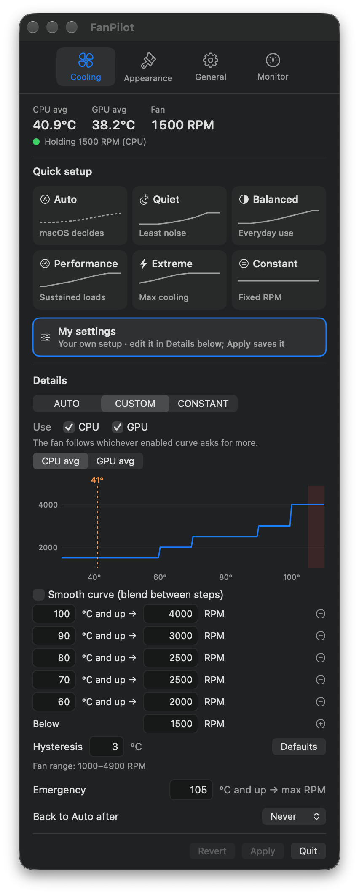
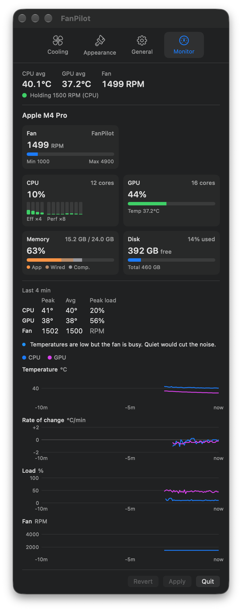
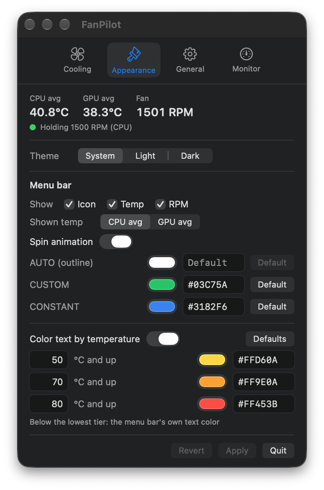
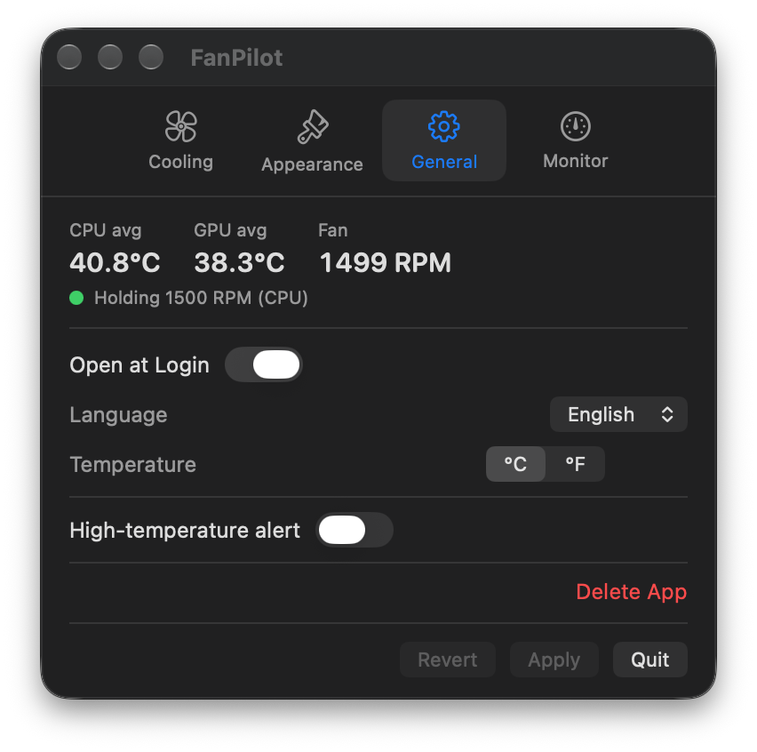
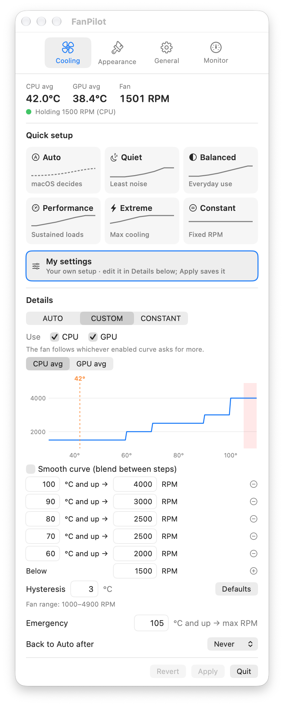
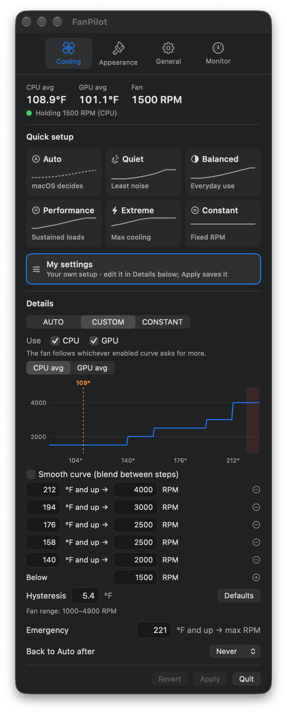

<div align="center">

# FanPilot

**A tiny, fail-safe fan controller for Macs that lives in your menu bar.**

One-click presets or your own CPU & GPU fan curves, a live system monitor, and one click to hand control back to macOS.

[한국어](README.ko.md) · English



</div>

---

## Contents

- [Features](#features)
- [Screenshots](#screenshots)
- [Requirements](#requirements)
- [Install](#install)
- [Using FanPilot](#using-fanpilot)
- [How it works](#how-it-works)
- [Safety](#safety)
- [Performance](#performance)
- [Build from source](#build-from-source)
- [Uninstall](#uninstall)
- [Files and locations](#files-and-locations)
- [Troubleshooting](#troubleshooting)
- [Disclaimer](#disclaimer)
- [Acknowledgements](#acknowledgements)
- [License](#license)

## Features

**Cooling**
- **Quick setup, one click:** Auto, Quiet, Balanced, Performance, Extreme, Constant. Presets are defined as a share of each fan's own RPM range, so they fit any Mac.
- **My settings:** your own setup, kept separately. Edit the curve in *Details* and Apply; picking a preset never overwrites it.
- **CPU and GPU curves together.** The fan follows whichever enabled curve asks for more, so GPU-only loads (games, rendering, ML) still spin it up.
- **Step or smooth curves**, with a live chart that marks the current temperature and the emergency zone.
- **Hysteresis**, so the fan doesn't hunt at a step boundary.
- **Emergency override:** max RPM at 105 °C (adjustable) in any mode except Auto.
- **Back to Auto after** 15 min / 30 min / 1 hour, handled by the service, so it works even if the app is closed.
- **Every fan:** Macs with two or more fans get a card per fan; all fans follow the curve proportionally to their own range.

**Monitor**
- Chip and core counts (performance / efficiency, GPU cores), per-fan RPM with min/max.
- CPU load with a bar per core, GPU load, memory (app / wired / compressed), startup disk free space.
- Last-10-minute charts: temperature, **rate of change (°/min)**, load and fan RPM, with peak/average figures and plain-language advice ("running warm, Performance cools better", "temperatures are low, Quiet would cut the noise").

**Menu bar**
- The fan icon spins in proportion to the real RPM (can be turned off).
- Show any combination of icon, temperature and RPM. Fixed-width digits, so it never jiggles.
- **Left-click** cycles Auto → Custom → Constant. **Right-click** opens the settings.
- Icon color per mode and temperature-based text color (yellow ≥ 50 °C, orange ≥ 70 °C, red ≥ 80 °C by default).

**General**
- High-temperature notification (opt-in, once per hot spell).
- Theme: System (default), Light, Dark. Language: 한국어 / English. Units: °C / °F.
- Self-installing service, one-button full uninstall.
- **Very light:** about 0.7 % CPU and 25–35 MB with the settings window open.

| Auto | Custom | Constant | Temperature color | °F |
|:---:|:---:|:---:|:---:|:---:|
|  |  |  |  |  |

## Screenshots

| Cooling | Monitor |
|:---:|:---:|
|  |  |

| Appearance | General |
|:---:|:---:|
|  |  |

| Light theme | Fahrenheit |
|:---:|:---:|
|  |  |

## Requirements

- Any Mac that runs macOS 14: **Apple Silicon (M1–M5)** or **Intel**. One universal app.
- FanPilot reads which fan keys your Mac has and uses those, so it adapts to each generation: `F0Md` on M1–M4 and Intel, `F0md` on M5, plus the `Ftst` unlock that M3/M4 MacBook Pros need.
- **Fanless Macs** (MacBook Air): there's no fan to control, so the app says so plainly and works as a temperature and load monitor.
- **macOS 14 Sonoma** or later.
- An administrator password, once, to install the fan-control service.

> Tested on a Mac mini (M4 Pro, one fan) running macOS 27.2. The M5, M3/M4 MacBook Pro and Intel paths follow what those Macs expose but haven't been run on that hardware yet.
> Macs with two or more fans are supported in code and the layout was checked with simulated fans, but multi-fan control **hasn't been verified on real hardware yet**. Reports are welcome.

## Install

1. Download `FanPilot.dmg` from the [Releases](../../releases) page.
2. Open it and drag **FanPilot** into **Applications**.
3. Open FanPilot. It isn't notarized, so the first time macOS may say it can't verify the developer: right-click the app → **Open** → **Open**, or click **Open Anyway** in **System Settings → Privacy & Security**.
4. Click **Install (admin password)** at the top of the window. This installs the small background service that actually sets the fan speed.

The service starts at boot. To have the menu bar item at login too, turn on **General → Open at Login**.

## Using FanPilot

### Menu bar

| Action | Result |
|---|---|
| Left-click | Next mode: Auto → Custom → Constant → Auto |
| Right-click (or ⌃-click) | Settings popover |
| Hover | Current mode |

An **outline** fan means macOS is in control (Auto); a **filled** fan means FanPilot is (Custom or Constant).

### Tabs

- **Cooling**
  - *Quick setup* tiles and *My settings* apply immediately.
  - *Details* holds the full editor: mode, CPU/GPU curves (*Use* picks which are active, the segmented control picks which you edit), smooth curve, steps (⊕/⊖), *Below* RPM, hysteresis, emergency temperature. These take effect when you click **Apply**; **Revert** discards them. Applying a hand-made curve saves it as *My settings*.
  - *Back to Auto after* sets a timer for Custom/Constant.
- **Appearance:** theme, what the menu bar shows, which temperature it shows, spin animation, icon color per mode (picker or hex), temperature-based text color.
- **General:** open at login, language, temperature unit, high-temperature alert, Delete App.
- **Monitor:** chip, fans, CPU/GPU/memory/disk, last-10-minute summary, advice and charts.

### Presets

Fractions of the fan's range (Mac mini M4 Pro: 1000–4900 RPM), smooth curve on:

| Preset | Below | Steps |
|---|---|---|
| Quiet | 0 % | 60 °C 10 % · 70 °C 25 % · 80 °C 45 % · 90 °C 75 % |
| Balanced | 5 % | 55 °C 15 % · 65 °C 30 % · 75 °C 50 % · 85 °C 70 % · 95 °C 90 % |
| Performance | 15 % | 50 °C 30 % · 60 °C 45 % · 70 °C 65 % · 80 °C 85 % · 90 °C 100 % |
| Extreme | 35 % | 45 °C 50 % · 55 °C 70 % · 65 °C 90 % · 75 °C 100 % |

### Temperature unit

°C is the default. With °F every temperature is shown and typed in °F; storage and control stay in °C, so switching never changes how the fan behaves. Hysteresis is a *difference*, so it's only scaled (3 °C = 5.4 °F).

## How it works

```
┌───────────────────────────┐    config.json    ┌──────────────────────────────┐
│ FanPilot.app  (user)      │ ────────────────▶ │ fanpilotd  (root, launchd)   │
│  menu bar · settings      │                   │  supervisor ⇄ controller     │
│  monitor                  │ ◀──────────────── │  every 2 s:                  │
└───────────────────────────┘   fanpilot.json   │   read sensors (SMC)         │
                                (status +       │   pick target RPM            │
                                 readings)      │   write F{i}Md / F{i}Tg      │
                                                └──────────────────────────────┘
```

- **`fanpilotd`** runs as root because writing fan speeds to the SMC needs root. It is two processes from one binary that watch each other (see [Safety](#safety)). Every 2 seconds the controller reads the sensors, picks the target RPM and writes it to every fan.
- **`FanPilot.app`** is a normal user app. It writes your settings to `/Users/Shared/FanPilot/config.json` and shows what the service reports in `/var/run/fanpilot.json`. Root is only needed to install or remove the service.
- **Sensors:** CPU average over all `Tp*` (performance) and `Te*` (efficiency) sensors, GPU average over `Tg*` (Intel: `TC*` and `TG*`). A 3-sample median removes one-tick spikes from idle cores.
- **Fans:** `F{i}Md = 1` puts fan *i* in manual mode, `F{i}Tg` sets its target, `F{i}Md = 0` gives it back to macOS.

## Safety

FanPilot is built so that a mistake or a crash leaves the fan under macOS control, not stuck at a low speed.

- **Any exit hands the fans back to macOS,** including `kill -9` and crashes. A tiny supervisor (no timers, 0 % CPU) and the controller watch each other; whichever dies, the other immediately sets every fan back to macOS control. Measured: back to Auto within 0.3 s after `kill -9` of either process.
- If the config, a sensor or a fan write fails, the fans go back to macOS control and the app says why.
- The **emergency temperature** overrides every curve and constant setting.
- RPMs are always clamped to each fan's hardware range.
- A crashing controller is restarted with back-off (macOS keeps control meanwhile); launchd restarts the supervisor.
- Targets are re-asserted every 30 s in case something else changed them.

## Performance

Measured on a Mac mini M4 Pro (30-second averages):

| Process | CPU | Memory |
|---|---|---|
| `FanPilot.app`, settings window open | ~0.7–0.9 % | 23–35 MB (by tab) |
| `fanpilotd` controller | ~0.5 % | ~3 MB |
| `fanpilotd` supervisor | 0 % | ~2 MB |

How it stays light:
- The service reads the sensors once; the app uses its readings instead of polling the SMC.
- The menu bar fan spins on a Core Animation layer; the app only retunes its speed when the RPM changes.
- Charts are plain shapes, not Swift Charts or Canvas (those set up a GPU context costing ~120 MB on first draw).
- Values that change every tick live in their own object, so only the views showing them redraw. Charts redraw at most every 10 s.
- The service only writes to the SMC when a target changes and re-reads the config only when it changes.

## Build from source

Only the **Xcode Command Line Tools** are needed.

```sh
xcode-select --install          # if needed
git clone https://github.com/flowerjun/FanPilot.git
cd FanPilot
./build.sh                      # → build/FanPilot.app and build/FanPilot.dmg
```

Copy the app to `/Applications` and open it; it offers to install or update the service. Terminal alternatives: `sudo ./install.sh`, `sudo ./uninstall.sh`.

```
Sources/
  Shared/  SMC.swift (IOKit SMC client), Sensors.swift, Config.swift      ← app and daemon
  Daemon/  main.swift  (supervisor + controller, curves, hysteresis, safety)
  App/     FanPilotApp.swift (model), ContentView.swift (tabs), Monitor.swift,
           Charts.swift, Components.swift (shared UI), Presets.swift,
           StatusBarController.swift, LiveState.swift, SystemInfo.swift,
           DaemonInstaller.swift, Localization.swift
scripts/   fanpilot-admin.sh  (root install/uninstall, bundled into the app)
tools/     make_icon.swift
```

## Uninstall

**General → Delete App**, confirmed twice. FanPilot gives the fans back to macOS, removes the service, its launchd job, status file and log, your settings, preferences and login item, then deletes itself. Nothing is left behind. Terminal: `sudo ./uninstall.sh`.

## Files and locations

| Path | What |
|---|---|
| `/Applications/FanPilot.app` | The app |
| `/usr/local/libexec/fanpilotd` | Fan-control service |
| `/Library/LaunchDaemons/com.flowerjun.fanpilot.plist` | Starts the service at boot |
| `/Users/Shared/FanPilot/config.json` | Fan settings |
| `/var/run/fanpilot.json` | Service status and readings |
| `/var/log/fanpilotd.log` | Service log |
| `~/Library/Preferences/com.flowerjun.fanpilot.plist` | App preferences (My settings, colors, display, language, unit, theme) |

## Troubleshooting

**Red dot, "Fan control service isn't running"** — click **Install** / **Update** at the top of the window. From the Terminal: `sudo launchctl print system/com.flowerjun.fanpilot | grep state` and `cat /var/run/fanpilot.json`.

**macOS won't open the app** — it isn't notarized: right-click → **Open**, or **System Settings → Privacy & Security → Open Anyway**.

**The fan ignores a GPU-heavy task** — in Cooling → Details, make sure **GPU** is checked under *Use*.

**I want macOS back in charge now** — left-click the menu bar icon until it shows the outline fan, or pick **Auto**.

## Disclaimer

FanPilot writes directly to your Mac's System Management Controller. It's built defensively, but running fans slower than macOS would can raise temperatures; that's your call. Provided as is, without warranty. Apple, Mac and macOS are trademarks of Apple Inc.; FanPilot isn't affiliated with Apple.

## Acknowledgements

Some feature ideas (quick presets, a monitor panel, timed return to Auto, temperature alerts) were inspired by [FanBar](https://github.com/helson-lin/FanBar). FanPilot is an independent implementation; it shares no code or assets with FanBar.

## License

[MIT](LICENSE)
